<!-- Banner -->

  
  

  

    
    
  

# 👨‍💻 Robert | Software Engineer & Consultant

If your team copies the same data between three tools every week, I can probably make that stop.

I run <a href="https://uphillsolutions.tech/?utm_source=github&utm_medium=profile&utm_content=intro">UpHill Solutions</a>, a one-person software shop. I build custom apps, connect the systems you already pay for, and automate the boring parts. I use whatever stack fits the job, and I ship in weeks, not quarters.

When I'm not at a keyboard, I'm probably hiking uphill with my family (commitment to the brand).

## 🛠️ What that looks like

Some of what I've been building lately:

- A communication platform for court-ordered cases, where every message has to hold up in front of a judge.
- A live sync that pushes employee changes from UKG into a senior living community's app the moment HR saves them.
- AI that sorts flagged messages so human moderators see the risky ones first. The AI never makes the call.
- The backup, restore and cleanup jobs nobody thinks about until the day they matter.

Some of it runs on Knack, some on Ruby, Node or Google Apps Script. I pick the tool for the problem, not the other way around.

[Read the case studies](https://uphillsolutions.tech/work/?utm_source=github&utm_medium=profile&utm_content=recent_work) or [book a free 30-minute call](https://uphillsolutions.tech/contact/?utm_source=github&utm_medium=profile&utm_content=recent_work).

## 🛡️ Software your team can actually change

Most custom software freezes the day the contractor leaves. I write down the rules that matter, test them, and set up AI with guardrails so your team can ask for changes without breaking things. If something gets hairy, you call me.

## 🌵 Open Source

On weekends I build tools for myself and give them away. [DesertFox](https://github.com/uhs-robert/desertfox), which drives Firefox from the keyboard, took me under two weeks. My favorites are pinned at the bottom of this page.

If they save you time, support the work: <kbd><a href="https://github.com/sponsors/uhs-robert?metadata_source=profile">💖 Sponsor</a></kbd> <kbd><a href="https://ko-fi.com/uphillsolutions">☕ Ko-fi</a></kbd>

## 🧗 Why "UpHill"?

I love Greek mythology, especially Sisyphus: a man cursed to push a boulder up a hill, every day, forever.

We all have a boulder. Mine was `CTRL+C` and `CTRL+V`, doing the same thing over and over. So I started automating it, and my boulder keeps getting smaller.

That's the job now. We talk about where your team loses time, agree on the smallest fix worth building, and I build it.

## 🤝 Get in Touch

The easiest start is a [free 30-minute call](https://uphillsolutions.tech/contact/?utm_source=github&utm_medium=profile&utm_content=contact). Bring the task your team hates most.

📬 <robert.hill@uphillsolutions.tech> · 💼 [LinkedIn](https://www.linkedin.com/in/robert-hill-a6a189125/)

## 🧰 Languages and Tools

<h3 align="left">Fluent in...</h3>

  

<h3 align="center">Shipping on...</h3>

  

<h3 align="right">Powered by...</h3>

  

## 📊 GitHub Stats

  

  
<em>The climb to the top continues below</em>

  <!-- Profile View Counter: Added 12/29/2025 -->
  
    <!--  -->

